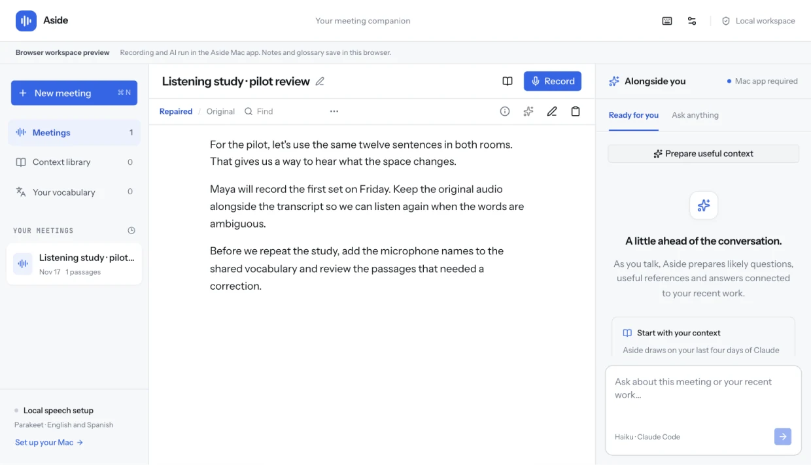

# Aside for macOS

Record a meeting on your Mac, transcribe it locally, and edit the result while keeping the original recognition and audio. Search for a passage, correct a misheard term, and export the document. You can supply names and vocabulary ahead of time or attach supporting documents during the meeting.



**[Listen to the public speech evaluation](https://essencesentry.github.io/aside-macos/speech-evaluation/)**. Compare raw and prepared audio recognition across 18 readers, including a clip where preparing the audio introduced a word error. [Reproduce the evaluation](docs/speech-evaluation/README.md).

## Try the interface

Use Node.js 24 and npm.

```bash
npm ci
npm run dev
```

Open the local address printed by Vite. Create a meeting, add a passage, and correct a word in the document. The browser preview saves manually entered content in that browser. Recording and speech recognition run in the native app.

## Run the Mac app

Use Apple Silicon, macOS 14 or later, Swift 6.2 or later, Node.js 24 and the Apple command-line developer tools.

```bash
npm ci
npm run macos:build
npm run macos
```

The build creates an ad-hoc signed `build/Aside.app`. In **Settings**, download Parakeet for live transcription. Whisper Turbo is available for a second recognition pass. Start a short recording, stop it, and compare **Original** with **Repaired**. Microphone and optional system audio have separate permission prompts.

## Data and optional assistants

Recordings, locally downloaded speech models, and transcript versions live on the Mac. When you enable an assistant, Aside uses the configured Claude or Codex CLI. Assistant requests can include transcript text, meeting context, relevant document passages, and enabled work or session context. You can use local recording and transcription with the assistant disabled. The browser preview and the native app have separate storage.

## Development

- `npm run test:ui` builds the web interface and exercises editing, navigation, and export with synthetic text.
- `npm run test:native` runs the Swift tests on macOS, including audio capture, checkpoint recovery, and recording export.
- [Native app](native/Sources/Aside) · [Transcript interface](src/screens/transcript.tsx) · [Native tests](native/Tests) · [Browser interaction tests](scripts/smoke-ui.mjs)

## Credits

Live speech recognition uses [NVIDIA Parakeet TDT 0.6B v3](https://huggingface.co/nvidia/parakeet-tdt-0.6b-v3) (CC BY 4.0 model weights), and [Silero VAD](https://github.com/snakers4/silero-vad) for speech activity detection, converted for Apple Silicon by [Fluid Inference](https://github.com/FluidInference/FluidAudio). FluidAudio is licensed under Apache 2.0. The app downloads the model separately rather than committing model weights to this repository.

Final speech recognition uses OpenAI Whisper Turbo through the [WhisperKit native runtime](https://github.com/argmaxinc/argmax-oss-swift) (MIT). Models download separately into private application storage.

Speaker diarization uses the MIT-licensed [SpeakerKit runtime](https://github.com/argmaxinc/argmax-oss-swift) and its [CC BY 4.0 model conversion](https://huggingface.co/argmaxinc/speakerkit-coreml). Speaker models and voice references are stored separately in private application storage.
